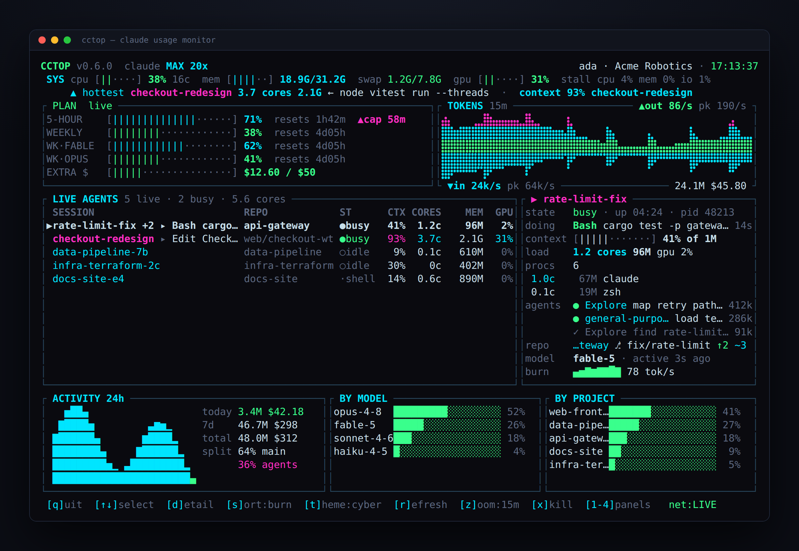
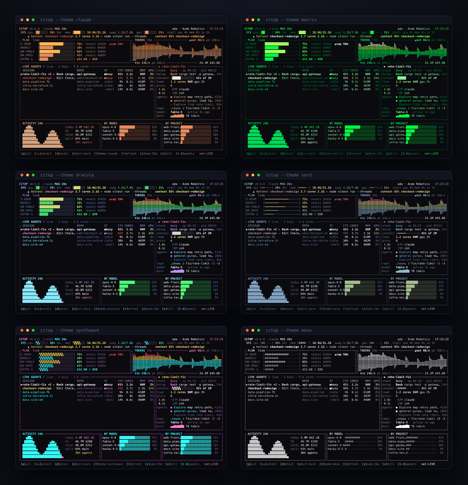
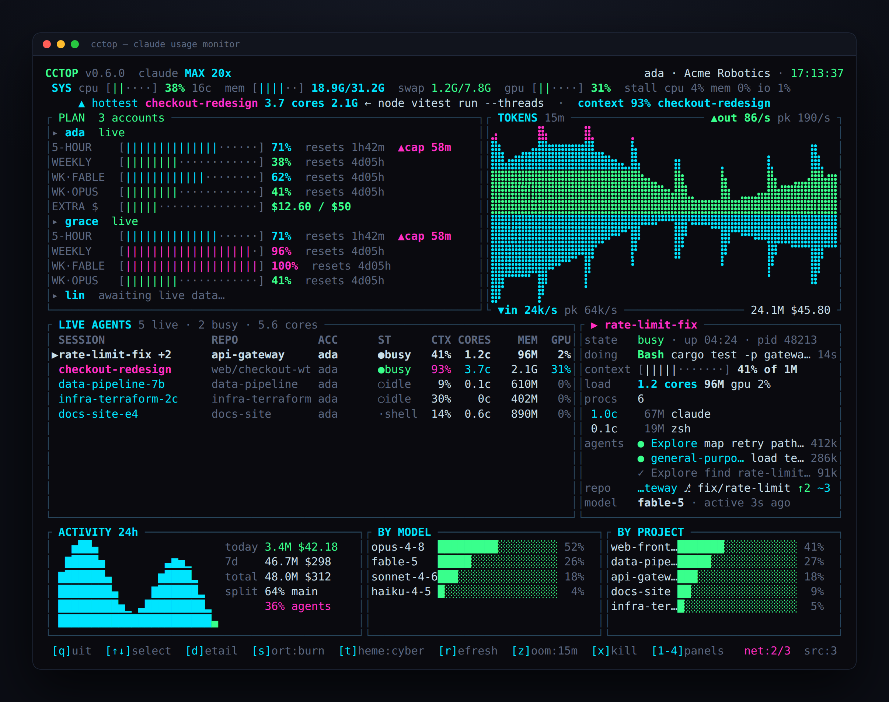

# cctop

A [btop](https://github.com/aristocratos/btop)-style terminal monitor for your Claude usage and running Claude Code agents.



Instead of keeping the **claude.ai usage tab** open in your browser, run `cctop` and watch your plan limits, token spend, and every running Claude Code agent right in your terminal — live.

## Install

**Quick install** — prebuilt binary, no Rust needed.

Linux / macOS (Intel & Apple Silicon):

```sh
curl -fsSL https://raw.githubusercontent.com/y0av/cctop/master/install.sh | sh
```

Windows (PowerShell):

```powershell
irm https://raw.githubusercontent.com/y0av/cctop/master/install.ps1 | iex
```

The rest of the options need a [Rust toolchain](https://rustup.rs) (`cargo`). No system libraries — TLS is bundled (rustls).

**From git:**

```sh
cargo install --git https://github.com/y0av/cctop
```

**From source:**

```sh
git clone https://github.com/y0av/cctop
cd cctop
cargo install --path .
```

**Just build, don't install:**

```sh
git clone https://github.com/y0av/cctop && cd cctop
cargo build --release
./target/release/cctop
```

Either install puts `cctop` on your `PATH` (`~/.cargo/bin`). Then just run:

```sh
cctop
```

## What it shows

- **Plan** — your live 5-hour and weekly limits (the same gauges as *claude.ai/settings/usage*) with reset timers, including the **per-model weekly caps** (Fable / Opus / Sonnet — whatever your plan enforces) and your **extra-usage credits** when overage is enabled. Falls back to a local estimate when offline.
- **▲cap prediction** — cctop tracks how fast each window is climbing; if your current burn rate would hit 100% *before* the reset, the gauge grows a red `▲cap 58m` warning so you can throttle down (or switch models) in time.
- **Tokens** — a live braille graph of token throughput across every session, next to the plan gauges: generated tokens grow up from the middle, context read (input plus cache) hangs below it, each scaled to its own peak, with the current rate, the peak and the window's total tokens and cost on the frame. `z` cycles the window (5m / 15m / 1h / 6h). A turn's tokens land when the turn finishes (that is when Claude Code writes its usage), so one long turn shows as a single burst.
- **System** — a strip under the header with machine CPU, memory, swap, GPU busy % and VRAM, and (Linux) pressure stalls: the share of the last 10 s that something waited on CPU, memory or IO. Below it, a diagnosis line names the hungriest agent and the process inside it doing the work (`▲ hottest hoteleak 11.8 cores ← python -c ← pytest`), plus warnings for thrashing, a saturated CPU, full swap, orphaned processes (and the ports they still hold) and any agent whose context is over 90% full.
- **Live agents** — every running Claude Code session as a process row: session title (with a `+2` badge while it has subagents running, and what it is executing right now, `▸ Bash cargo test`, when there is room), repo (with the worktree or subfolder when it differs), model, busy/idle, **context fill** (CTX: how much of the model's window the last turn used, amber from 75%, red from 90%), uptime, and the **CPU (in cores, averaged over a few seconds), memory and GPU of its whole process tree**: the agent plus every shell, test runner, dev server and browser it started. On Linux, processes that escaped the tree are still traced back through the `CLAUDE_PID` variable Claude Code puts in their environment, and ones whose session has died show up as `†orph` rows. The title is the one Claude generated for the session, or what you set with `/rename`; a name you or the agent chose is highlighted. Select a row (arrows, `j`/`k`, mouse wheel, or **click**) and the **drill-down panel** shows the tool call in flight (or the last one and when), a context bar with the window size and how many times the session has compacted (`↻2`), the TCP ports its process tree listens on (Linux), the top processes (with Claude's shell wrapper unwrapped to the real command, and their folder), its subagents (running ones first, with type, task and tokens), the repo with branch, ahead/behind and changed files, then the session totals: tokens in/out/cache, cost, last activity, working dir.
- **Activity** — a 24-hour token column chart with today / 7-day / lifetime totals and cost, the main-vs-subagent split, and breakdowns by model and project.

Token data is read locally from `~/.claude` (and any extra dirs you point it at — see [Multiple config dirs](#multiple-config-dirs)); the live plan gauges reuse your existing Claude Code OAuth login (Pro/Max). Nothing leaves your machine except the same usage request the CLI already makes.

Works on Linux, macOS and Windows.

## Keys & mouse

`q` quit · `↑ ↓` select · `enter`/`d` toggle drill-down · `s` cycle sort (burn / cpu / mem / uptime) · `t` cycle theme · `r` refresh · `z` token graph window · `x` kill · `1`–`4` toggle the system strip, plan gauges, token graph and bottom row

`x` asks first, naming the target, and sends SIGTERM only on `y`. On a running agent it terminates the `claude` process alone (anything it started that outlives it then shows up as an orphan); on a `†orph` row it terminates every process the dead session left behind. It is disabled under `--demo`.

The mouse works too: **click** an agent row to select it, **scroll** to move the selection.

## Themes



Press `t` to cycle themes live — the pick is remembered across runs (`~/.config/cctop/theme`) — or start with `--theme NAME`. Every theme restyles the whole UI: palette, border glyphs, gauge & bar characters.

| theme | vibe |
|-------|------|
| `cyber` | neon green/cyan on black — the classic (default) |
| `claude` | warm Anthropic terracotta, rounded corners |
| `matrix` | green phosphor CRT |
| `dracula` | the classic purple/pink dark palette |
| `nord` | calm arctic frost, thin-line gauges |
| `synthwave` | hot pink & cyan, double-line frames |
| `mono` | grayscale ASCII brutalism |

## Flags

| flag | what it does |
|------|--------------|
| `--demo` | run with synthetic data — no account needed |
| `--no-net` | local data only, never touch the network |
| `--no-update-check` | skip the daily check for a newer release (see [Updating](#updating)) |
| `--once` | print a one-shot text snapshot and exit |
| `--theme NAME` | pick a theme (see [Themes](#themes)) |
| `--config-dir DIR` | also read another Claude config dir (repeatable) — see [Multiple config dirs](#multiple-config-dirs) |

## Updating

cctop never updates itself. When a newer release exists, the header grows an `↑ v0.4.2` marker next to the version and you update by re-running whichever way you installed:

```sh
# installer (Linux/macOS) — same one-liner as the install
curl -fsSL https://raw.githubusercontent.com/y0av/cctop/master/install.sh | sh

# Windows
irm https://raw.githubusercontent.com/y0av/cctop/master/install.ps1 | iex

# cargo installs need --force, or cargo skips the reinstall
cargo install --git https://github.com/y0av/cctop --force
```

The check asks the GitHub releases API for the latest tag at most **once a day** (the answer is cached in `~/.config/cctop/update`), on a background thread so it never delays a frame. It downloads nothing, sends nothing about you, and is skipped entirely under `--no-net` and `--demo`. To turn it off: `--no-update-check`, or set `CCTOP_NO_UPDATE_CHECK=1`.

## Multiple config dirs

By default cctop reads the same config dir Claude Code itself uses: `$CLAUDE_CONFIG_DIR` if set, otherwise `~/.claude`.

If you run Claude Code under more than one config dir — a sandbox launched with a custom `CLAUDE_CONFIG_DIR`, or a second account — point cctop at the extras to watch **all** of their agents, token usage **and plan limits** in one view. Pass the dir that contains `projects/` and `sessions/`:

```sh
# repeatable flag
cctop --config-dir ~/envs/sandbox/claude

# or, persistently, via an env var — a path list (':' on Unix, ';' on Windows)
export CCTOP_CONFIG_DIRS=~/envs/sandbox/claude:~/envs/other/claude
cctop
```

Live agents and token totals are merged across every dir (duplicates collapse, missing dirs are ignored). Every dir that carries its own login (`.credentials.json`) gets its **own live plan section** — 5-hour, weekly and per-model weekly gauges per account — so you can watch several accounts' limits side by side:



The header identity follows the base dir; a dir that has never logged in is skipped, and the same login mounted twice collapses to one section. When more than one dir is active the footer shows `src:N` and `net:live/total`. With nothing extra set, behavior is unchanged — just `~/.claude`, one plan section, exactly the classic layout.

## License

MIT
